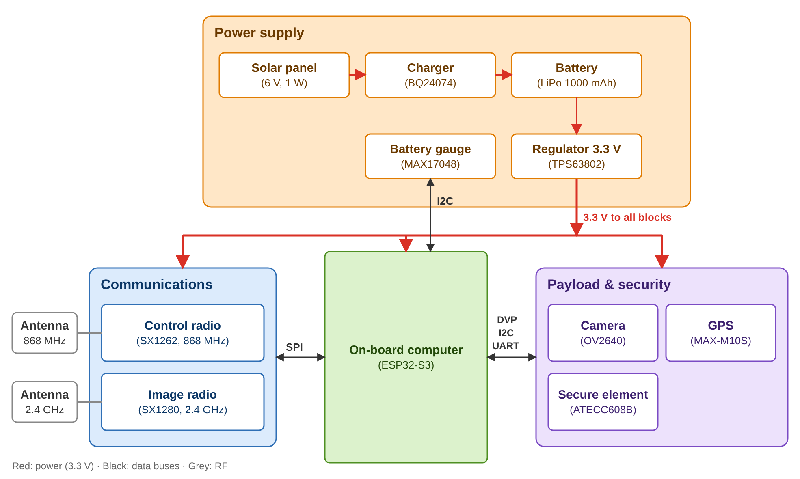

# Signed Camera

With modern AI it is getting harder and harder to tell fake images from real ones. In 2026, AI-generated satellite images of a "destroyed" US radar got millions of views before anyone proved they were fake [1]. In this project I am building a low-cost, low-power camera for CubeSats that signs every image the moment it is taken, using a secure element, and includes the GPS position and the time in the signature. That way anyone on the ground can check that the image is real and hasn't been modified.

The idea itself is not new. Signing images at capture has already been proposed for satellites [2][3], and some professional cameras already do it with the C2PA standard [4][5]. What I want to add is two things. First, the signature should still work when some packets are lost on the radio downlink, which happens a lot on low-power satellite links. Second, if you crop the image, the crop should still be verifiable, while any other change gets detected. And since this is a student project, I'm trying to keep it as cheap as possible.

**Status:** design phase. I've picked the components and done the power budget. Next step is the first prototype: take a photo, sign it and verify it on a PC.

## How it works

1. The camera (OV2640) takes the picture and the ESP32-S3 gets it as a JPEG. At the same moment it reads the time and the GPS position, and increases a counter that goes up with every photo.
2. The image is split into blocks and each block is hashed with SHA-256. The hashes are combined into a Merkle tree, and its root works as a single fingerprint of the whole image. Since every block can be checked on its own, crops can be verified and losing packets doesn't break everything.
3. The ESP32 sends the root, the time, the GPS position and the counter to the secure element (ATECC608B), which signs them with ECDSA P-256. The private key is generated inside the chip and can't be read out, not even by the ESP32.
4. The image goes down to the ground by radio in packets, together with the signature and the extra data needed to check each block.
5. On the ground, the signature is checked with the chip's public key. The verifier will be open source: first a Python script, and later a web page that does everything in the browser.
   - If some packets are lost, the blocks that arrived can still be verified.
   - If someone crops the image, the crop can still be verified.
   - If someone changes even one pixel, that block fails.
   - The counter stops someone from passing an old photo off as a new one.

Steps 2 and 5 are the planned design. The first prototype will only sign the whole image and verify it on a PC.

## Block diagram

## Components

| Block | Part | Interface | Why |
|---|---|---|---|
| Microcontroller | ESP32-S3 | – | Camera port (DVP), PSRAM, hardware crypto, Wi-Fi for testing |
| Camera | OV2640 | DVP | 2 MP, hardware JPEG, lots of examples online |
| Secure element | ATECC608B | I2C | ECDSA P-256 in hardware, the private key can't be read out |
| GPS | u-blox MAX-M10S | UART | Position and time for the signature, 1 s hot start, ~12 mA |
| Control radio | SX1262 (868 MHz LoRa) | SPI | Telemetry and commands, −148 dBm sensitivity |
| Image radio | SX1280 (2.4 GHz) | SPI | Image downlink, up to 1.3 Mbps (FLRC) |
| Battery | LiPo 3.7 V, 1000 mAh | – | About 2 days without sun, with margin for ageing |
| Regulator | TPS63802 (buck-boost) | – | Uses the whole LiPo range down to 3.0 V, 11 µA quiescent |
| Charger | BQ24074 | – | Power path (the system runs from the panel while charging), copes with a weak panel |
| Solar panel | 6 V, 1 W | – | Matches the power budget |
| Battery gauge | MAX17048 | I2C | Battery percentage for telemetry, no sense resistor needed |

### Why a buck-boost and not an LDO?

An LDO needs the battery above roughly 3.55 V to give a stable 3.3 V, so I would lose around 15–25 % of the LiPo's capacity. The TPS63802 keeps 3.3 V until the battery drops to 3.0 V, at around 90 % efficiency and with only 11 µA of quiescent current.

The custom PCB will also have a resettable PTC fuse, a P-MOSFET for reverse polarity, a main switch, an NTC on the battery, a TVS on the panel input and two load switches (TPS22918) to turn off the camera and the GPS between photos.

## Power budget

I assumed a 10-minute cycle: telemetry (10 × 0.5 s), listening for commands (10 × 1 s), GPS fix (5 s), photo and signature (3 s), image downlink (30 s), and sleep the rest of the time.

| | Value |
|---|---|
| Average current (3.3 V) | 14.6 mA |
| Peak current | 148 mA |
| Energy needed per day (with margin) | 1.87 Wh |
| Energy from the panel per day (1 W, 5 h of sun) | 3.20 Wh |
| Daily balance | +2.05 Wh |
| Minimum battery capacity | 506 mAh (I chose 1000 mAh) |

There is a good margin: the panel gives 3.20 Wh a day and the system needs 1.87 Wh, so there is room for more photos or longer transmissions. The image downlink is the longest active phase, so sending only the part of the image that matters (which croppable signatures allow [9]) is also the best way to save energy.

## Roadmap

- [x] Component selection
- [x] Power budget
- [ ] Prototype with ESP32-S3, OV2640 and ATECC608B: take, sign and verify an image on a PC
- [ ] Add GPS position and time to the signature
- [ ] LoRa control link (868 MHz)
- [ ] 2.4 GHz image downlink
- [ ] Schematic and PCB in KiCad

## Related work

Fake satellite images aren't just a theoretical problem. Researchers have shown that AI can generate realistic satellite images of places that don't exist [6], and they are already being used for disinformation [1]. Sandia proposed signing satellite images at capture [2][3], and cameras like the Leica M11-P already sign photos with C2PA [4][5]. Space Fabric uses secure elements on satellites, but to prove which software is running on board, not to sign images [7]. The CCSDS SDLS protocol authenticates the radio link [8], but once the image is saved on the ground that protection is gone. Croppable signatures exist for normal photos [9], but I couldn't find anyone using them for satellite images with packet loss, which is the gap this project tries to fill.

## References

1. AFP via Taipei Times, "Fake AI satellite imagery spurs war disinformation", March 2026. [Link](https://www.taipeitimes.com/News/world/archives/2026/03/10/2003853579)
2. S. Crosby, K. Brenning, "On Trusting Third-party Satellite Data", Small Satellite Conference, Utah State University, 2022. [Link](https://digitalcommons.usu.edu/smallsat/2022/all2022/105)
3. S. M. Crosby, W. Marchetto II, K. D. Brenning (Sandia National Laboratories), "Systems and methods for verification and authentication of remote sensing imagery", US Patent 11,646,896, 2023. [Link](https://patents.justia.com/patent/11646896)
4. Content Authenticity Initiative, "Leica launches world's first camera with Content Credentials", October 2023. [Link](https://contentauthenticity.org/blog/leica-launches-worlds-first-camera-with-content-credentials)
5. IEEE Spectrum, "Is that photo real?", on the Leica M11-P signing photos with a secure chipset. [Link](https://spectrum.ieee.org/leica-camera-content-credentials)
6. B. Zhao et al., "Deep fake geography? When geospatial data encounter Artificial Intelligence", *Cartography and Geographic Information Science*, 2021. [Summary](https://www.washington.edu/news/2021/04/21/a-growing-problem-of-deepfake-geography-how-ai-falsifies-satellite-images/)
7. F. Rezabek, D. Malkhi, A. Yahalom, "Space Fabric: A Satellite-Enhanced Trusted Execution Architecture", arXiv:2603.23745, 2026. [Link](https://arxiv.org/abs/2603.23745)
8. CCSDS 355.0-B, "Space Data Link Security Protocol", Consultative Committee for Space Data Systems. [Link](https://public.ccsds.org)
9. P. Perazzo et al., "JPEGs Just Got Snipped: Croppable Signatures Against Deepfake Images", arXiv:2512.01845, 2025. [Link](https://arxiv.org/abs/2512.01845)

## Author

Jorge Tarriño, Industrial Electronics and Automation Engineering student at Universidad Carlos III de Madrid.
